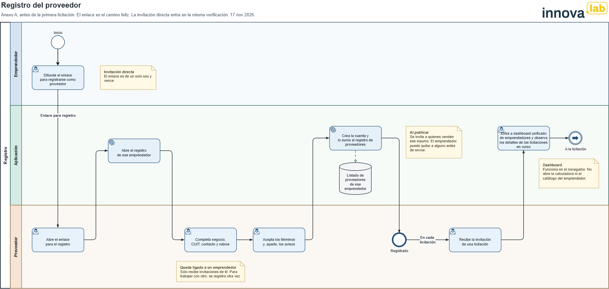
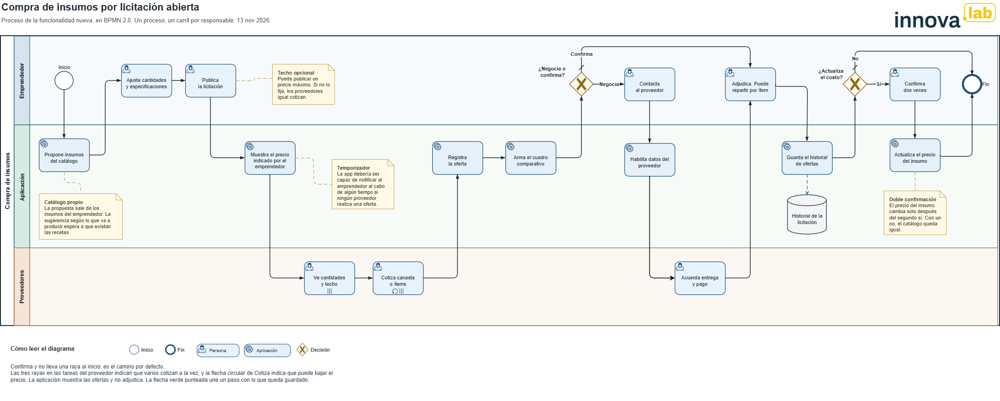

# 09 — Licitación de insumos: flujo y reglas vigentes

Documento único de la funcionalidad de licitaciones: qué es, quiénes participan, cómo se recorre el proceso de punta a punta y qué decisiones rigen hoy la primera versión. Los puntos abiertos, las dudas y los resguardos pendientes quedan registrados como trabajo pendiente de la funcionalidad.

## 1. Qué es y quiénes participan

Funcionalidad complementaria de la Calculadora de Costos: el emprendedor publica una compra de insumos, sus proveedores registrados compiten con ofertas selladas por rondas y el precio resultante puede alimentar el Maestro de Insumos.

- **Modelo:** subasta inversa por rondas con ofertas selladas. No es una subasta japonesa pura: en esa el proveedor solo acepta el precio de cada paso o sale; acá propone su propio precio.
- **Alcance:** la aplicación sistematiza el proceso. No interviene en el pago, la entrega ni el contrato, que se acuerdan entre emprendedor y proveedor.

| Actor | Responsabilidad |
| --- | --- |
| Emprendedor | Publica la licitación, conduce las rondas, elige con qué proveedor compra cada insumo y confirma las condiciones. |
| Proveedor | Participa con sus ofertas. No conoce a los demás proveedores ni sus precios. |
| Aplicación | Ejecuta las reglas, notifica en el panel, registra y compara. No adjudica ni elige por el emprendedor. |

| Término | Significado |
| --- | --- |
| Precio de partida | Techo inicial que publica el emprendedor. Ninguna oferta puede superarlo. |
| Ronda | Intervalo (6, 12 o 24 hs; 6 hs por defecto) en el que rige un precio objetivo. |
| Precio objetivo | Referencia de la ronda: precio objetivo anterior × (1 − % de baja). No es obligatorio alcanzarlo. |
| En carrera | Proveedores que pueden ofertar en la ronda. En la primera versión son todos los invitados, hasta el cierre. |

## 2. Recorrido de punta a punta

### 2.1 Requisito previo: registro del proveedor

Antes de la primera licitación, el proveedor queda registrado con el emprendedor. El enlace personal es el camino feliz; la invitación directa pasa por la misma verificación.

1. El emprendedor genera un enlace por proveedor y se lo envía por el medio que quiera.
2. El proveedor abre el enlace, completa negocio, CUIT, contacto y rubros, y acepta los términos.
3. Confirma su mail; recién entonces se crea la cuenta y el vínculo con ese emprendedor (RN-23).
4. Con una cuenta existente no vuelve a cargar sus datos: solo se vincula al nuevo emprendedor (RN-22).
5. El proveedor ve en su panel las licitaciones de los emprendedores con los que está vinculado, separadas por emprendedor.

### 2.2 Publicación

1. El emprendedor elige entre 1 y 20 insumos del Maestro de Insumos (RN-01, N-17), ajusta cantidades y especificaciones y publica, o guarda un borrador (N-31).
2. La aplicación sugiere el precio de partida de cada insumo desde el catálogo; es obligatorio y se puede cambiar (RN-02, ES-02).
3. El emprendedor fija una sola vez el % de baja, la duración de cada ronda (6, 12 o 24 hs) y la cantidad de rondas (2 a 5). La duración total es el producto de ambos valores (RN-09, ES-01, ES-03).
4. Aparecen todos los proveedores registrados, preseleccionados y con sus rubros a la vista; el emprendedor destilda a quienes no quiere invitar (RN-05, ES-07).
5. La licitación recibe un número correlativo por emprendedor (N-20) y arranca al publicarse (N-12). Publicada, no se modifica: solo puede cancelarse antes del cierre (RN-03).

### 2.3 Ofertas por rondas

1. Cada ronda rige un nuevo precio objetivo calculado con el % de baja fijado al publicar; la aplicación avanza sola (RN-09).
2. El proveedor ve términos, insumos, cantidades, precio de partida y objetivo vigente, y su propia oferta. No ve su posición, cuántos compiten, el % de baja (N-21), el precio de catálogo ni las recetas (RN-06, RN-07).
3. En cada insumo puede bajar su precio o ratificarlo; nunca puede subirlo por encima de su última oferta, y la primera no supera el precio de partida. Sin respuesta, ratifica (RN-10). En una canasta cotiza cada insumo por separado y puede cotizar solo algunos (RN-20).
4. Al terminar la primera ronda, la aplicación avisa una sola vez qué insumos siguen sin ofertas. El emprendedor deja seguir (por defecto) o cancela la licitación entera (RN-18, ES-04, ES-13).
5. Durante el curso, el emprendedor ve la última oferta de cada proveedor por insumo, sin que la aplicación elija ni recomiende (RN-08, N-25).

### 2.4 Cierre y adjudicación

1. La licitación cierra sola al vencer la duración, según el reloj del servidor (hora de Buenos Aires); no se aceptan ofertas posteriores (RN-12).
2. La aplicación arma el cuadro comparativo por insumo: última oferta de cada proveedor, de menor a mayor, con la diferencia contra el precio de partida y contra el precio de catálogo al publicar (RN-13, N-19, N-25). Cada insumo sin ofertas queda desierto por separado; si ninguno recibió ofertas, la licitación entera queda desierta y no hay cuadro (RN-19).
3. El emprendedor elige un proveedor por insumo y acuerda el precio; puede repartir la compra entre proveedores distintos. Las ofertas no son vinculantes (RN-14, N-26).
4. Si pide negociar, la aplicación avisa al proveedor y le pasa el contacto del emprendedor; la negociación sigue fuera y su inicio queda registrado (RN-21, ES-06). Elegir sin negociar no genera ningún aviso (N-27).
5. Todo el proceso queda en el historial inmodificable con fecha y hora: el emprendedor ve todo y cada proveedor solo lo suyo (RN-17, N-30).

### 2.5 Orden de compra

La aplicación genera una orden por proveedor adjudicado con ítems, cantidades, precio acordado, subtotales, total, condiciones de entrega y pago, fecha y número correlativo propio de cada emprendedor (RN-15, ES-11, N-28). El emprendedor completa las condiciones, obtiene una página lista para imprimir o guardar como PDF y la envía por su cuenta; la aplicación no la manda (RN-24). Una vez generada, la orden es definitiva. Si el emprendedor lo pide, los proveedores no elegidos ven en su panel una nota de agradecimiento idéntica, sin precios ni resultados (RN-16, N-29).

### 2.6 Actualización del Maestro de Insumos

El precio acordado puede reemplazar al del insumo en el Maestro de Insumos y alimentar la Calculadora de Costos. Es opcional, exige doble confirmación y **queda fuera de la primera versión** (E-02): requiere un historial de precios que todavía no existe. Las reglas CC-01 a CC-05 y el detalle de indicadores están más abajo, en la sección 3.6.

## 3. Reglas vigentes

### 3.1 Publicación

| ID | Regla |
| --- | --- |
| RN-01 | Solo se licitan insumos del Maestro de Insumos. Las cantidades se sugieren a partir de recetas y producción planificada si existen; si no, se cargan a mano. |
| RN-02 | Por insumo (o canasta) se publican cantidad, especificaciones, precio de partida, duración de cada ronda (6, 12 o 24 hs; 6 hs por defecto) y cantidad de rondas (2 a 5; 4 por defecto). La duración total es rondas × duración de ronda. El precio de partida es obligatorio: se sugiere el precio actual del insumo y se puede dejar o cambiar. La canasta solo agrupa insumos: precio de partida, objetivo y ofertas van siempre por insumo. Cada licitación tiene número correlativo. |
| RN-03 | Publicada, la licitación no se modifica: solo puede cancelarse antes del cierre. Un insumo no puede estar en dos licitaciones activas a la vez (en esta versión solo hay una licitación activa por vez). |
| RN-04 | Los precios ofertados son finales, puestos en destino (impuestos y flete incluidos) y por unidad de medida: la misma base de la Calculadora de Costos. |

### 3.2 Participación y confidencialidad

| ID | Regla |
| --- | --- |
| RN-05 | Participan solo proveedores registrados con ese emprendedor. Al publicar aparecen todos, preseleccionados y con sus rubros a la vista; el emprendedor puede quitar a quienes no quiere invitar y solo los que quedan reciben la invitación. |
| RN-06 | Los proveedores no se conocen entre sí. Cada uno ve términos de la licitación (inicio, fin, insumos, cantidades, precio de partida y objetivo vigente) y su propia oferta. No recibe señales de su posición ni de cuántos compiten. |
| RN-07 | Ningún proveedor ve el precio de compra de referencia del emprendedor, su catálogo ni sus recetas. |
| RN-08 | El emprendedor ve la identidad de los proveedores y todas las ofertas, con nombre, desde el inicio. |
| RN-22 | Un proveedor tiene una sola cuenta y puede estar vinculado a varios emprendedores. Cada emprendedor lo vincula con su propio enlace; si ya tiene cuenta, entra con ella sin volver a cargar datos. Ve solo las licitaciones de sus emprendedores, separadas, y ningún emprendedor ve con cuáles otros trabaja. |
| RN-23 | El enlace de invitación es personal, sirve una sola vez y vence a los 7 días; si vence se genera otro. Antes de crear la cuenta se confirma el mail y se valida el CUIT (formato y dígito verificador). Si el CUIT ya tiene cuenta, no se crea otra: se entra con ella y queda vinculado. |
| RN-24 | Todos los avisos se muestran solo en el panel: invitaciones, rondas nuevas con su objetivo, pedidos de negociación, insumos sin ofertas y cierre con el cuadro listo. No hay mails, WhatsApp ni SMS por avisos; el único mail es el de confirmación de cuenta. |

### 3.3 Rondas

| ID | Regla |
| --- | --- |
| RN-09 | En cada ronda (6, 12 o 24 hs, según lo publicado) rige un nuevo precio objetivo. El % de baja se define una sola vez, al publicar, y la aplicación avanza las rondas y calcula el objetivo sin intervención. El objetivo es referencia, no obligación. |
| RN-10 | En cada ronda el proveedor puede mejorar con precio menor al suyo anterior (llegue o no al objetivo) o ratificar. Nunca oferta por encima de su último precio; la primera oferta no supera el precio de partida. Sin respuesta, ratifica. |
| RN-11 | En la primera versión todos los proveedores invitados siguen en carrera hasta el cierre: el emprendedor no puede excluir a ninguno durante la licitación. |
| RN-12 | La licitación cierra sola al vencer la duración y no se aceptan ofertas posteriores. Los horarios los fija el reloj del servidor (hora de Buenos Aires). |
| RN-18 | Si al terminar la primera ronda uno o más insumos no recibieron ofertas, la aplicación avisa una sola vez cuáles son. El emprendedor puede dejarla seguir (lo que pasa si no hace nada) o cancelar la licitación entera; no puede sumar proveedores ni quitar insumos. |
| RN-20 | En una canasta el proveedor cotiza cada insumo por separado y puede cotizar solo algunos. RN-10 se aplica insumo por insumo. En el cuadro, un insumo no cotizado figura sin oferta. |

### 3.4 Cierre y compra

| ID | Regla |
| --- | --- |
| RN-13 | Al cierre se arma un cuadro comparativo por insumo con la última oferta de cada proveedor y la diferencia contra el precio de partida y contra el último precio registrado del insumo. |
| RN-14 | El emprendedor decide con qué proveedor contacta para comprar cada insumo, puede repartir la compra por ítem y negociar. Las ofertas son de referencia, no vinculantes. |
| RN-15 | Con lo acordado se genera una orden de compra por proveedor adjudicado, con ítems, cantidades, precio unitario, total, condiciones de entrega y pago, fecha y número correlativo. El emprendedor completa las condiciones, obtiene una página imprimible o guardable como PDF y la envía por su cuenta. |
| RN-16 | Si el emprendedor lo ordena, se muestra en el panel de los proveedores no elegidos una nota de agradecimiento idéntica para todos, sin precios ni resultados. |
| RN-19 | Al cierre, cada insumo sin ofertas queda desierto por separado y el resto sigue normal. Si ningún insumo recibió ofertas, la licitación entera queda desierta y no se arma cuadro. Lo desierto queda en el historial y se puede publicar una licitación nueva para esos insumos. |
| RN-21 | Al elegir negociar, la aplicación avisa al proveedor y le comparte el contacto del emprendedor. La negociación sigue fuera de la aplicación y su inicio queda registrado en el historial. |

### 3.5 Trazabilidad

| ID | Regla |
| --- | --- |
| RN-17 | Se guarda de forma inmodificable todo el proceso (ofertas, rondas, % de baja, decisiones y órdenes, si las hubiera), con fecha y hora. El emprendedor ve el historial completo; cada proveedor, solo el suyo. |

### 3.6 Conexión con la Calculadora de Costos

El resultado es un precio final por unidad. Una vez confirmado, puede reemplazar al precio del insumo en el Maestro de Insumos y alimentar el Costo Variable Unitario.

1. Al cierre se presenta el cuadro comparativo (RN-13).
2. El emprendedor elige proveedor por insumo y acuerda condiciones (RN-14).
3. La aplicación pregunta "¿Actualizar el costo del insumo?"; por defecto, no.
4. Si responde que sí, muestra el impacto y pide una segunda confirmación.
5. Recién tras la segunda confirmación se actualiza el precio, con fecha, origen y valor anterior.
6. La Calculadora recalcula los indicadores afectados.

| ID | Regla |
| --- | --- |
| CC-01 | La actualización es opcional y exige doble confirmación. Con un "no", o sin la segunda confirmación, el catálogo queda igual. |
| CC-02 | Se carga el precio unitario final acordado en la unidad del catálogo. Si la compra se reparte entre varios proveedores, se carga el promedio ponderado por cantidades. |
| CC-03 | Antes de la segunda confirmación se muestra el impacto: precio anterior y nuevo, y el costo variable de los productos que usan el insumo. |
| CC-04 | Cada actualización guarda fecha, origen (licitación, número y fecha de publicación) y valor anterior en el historial de precios. |
| CC-05 | La actualización solo cambia costos: no toca precios de venta, estructura, mezcla ni producción planificada. |

Indicadores recalculados: Costo Variable Unitario, Contribución de una Unidad, Costo Total Unitario, Margen en Pesos, Margen sobre el Precio, % Recargo, Precio Sugerido, Contribución Ponderada, Punto de Equilibrio, Cuota en Unidades y Equilibrio en Pesos. No cambian Estructura, Mezcla ni Producción planificada.

Consideraciones: conviene actualizar solo si el volumen que logró el precio se va a sostener; los precios deben ser finales y puestos en destino (RN-04); el precio se carga como costo histórico, sin ajuste por inflación ni corrección de mermas.

## 4. Especificaciones decididas

Las 13 especificaciones están decididas; la sección "Abiertas" del documento de origen quedó sin puntos. Los detalles de cada una, con citas y ejemplos, están en el original preservado.

| ID | Tema | Decisión | Fecha | Reglas que cambia |
| --- | --- | --- | --- | --- |
| ES-01 | Rondas en la primera versión | Rondas automáticas: el % de baja se fija una vez al publicar y la aplicación avanza sola. Sin rondas el proveedor no ve su posición (RN-06) y no bajaría su oferta; con rondas manuales el emprendedor tendría que entrar cada 6 hs. | 20 nov 2026 | RN-09 |
| ES-02 | Precio de partida | Obligatorio, con sugerencia del precio actual del insumo. Las rondas necesitan un punto de partida y todo insumo licitado está en el Maestro (RN-01). | 20 nov 2026 | RN-02 |
| ES-03 | Duración | Ronda de 6/12/24 h (6 por defecto) y 2 a 5 rondas (4 por defecto); total = producto, sin rondas cortadas. Mínimo 2 porque con una no hay rondas; máximo 5 porque con 10 % de baja el quinto objetivo ya es el 66 % del precio de partida. | 20 nov 2026 | Ronda, RN-02, RN-09 |
| ES-04 | Aviso cuando nadie oferta | Al terminar la primera ronda, aviso una vez; dejar seguir o cancelar; cerrar sin ofertas deja la licitación desierta. | 21 nov 2026 | Agrega RN-18 y RN-19 |
| ES-05 | Canasta o ítem | La canasta solo agrupa; precio por insumo y el proveedor puede cotizar solo algunos. Un precio total rompería el cuadro, el reparto y CC-02. | 21 nov 2026 | RN-02; agrega RN-20 |
| ES-06 | Qué habilita la negociación | El emprendedor ve datos y ofertas desde el inicio (RN-08); al negociar, la aplicación avisa al proveedor, le pasa el contacto y lo registra (RN-17). | 21 nov 2026 | Agrega RN-21 |
| ES-07 | A quién se invita | Todos los registrados preseleccionados con rubros a la vista; el emprendedor destilda. Invitar a quien no vende un insumo no rompe nada (RN-20), así que no hace falta clasificar insumos. | 21 nov 2026 | RN-05 |
| ES-08 | Cuenta del proveedor | Una sola cuenta con varios vínculos: datos una vez, licitaciones separadas por emprendedor y confidencialidad entre emprendedores. | 21 nov 2026 | Agrega RN-22 |
| ES-09 | Enlace y verificación | Enlace personal de un uso, 7 días de vigencia, mail confirmado y CUIT con formato y dígito verificador (sin consultar AFIP en esta versión). | 21 nov 2026 | Agrega RN-23 |
| ES-10 | Canal de avisos | Solo el panel; sin mails, WhatsApp ni SMS. El único mail es el de confirmación de cuenta. No hay capacidad de envío masivo. | 21 nov 2026 | Agrega RN-24 |
| ES-11 | Orden y agradecimiento | Ambas en la primera versión: orden imprimible por proveedor adjudicado y nota en el panel. Se sacan el mail de próxima licitación y el consentimiento. | 21 nov 2026 | RN-15, RN-16 |
| ES-12 | Proveedores en carrera | Todos los invitados hasta el cierre, sin exclusión. El resultado es el mismo porque las ofertas no obligan (RN-14). | 21 nov 2026 | En carrera, RN-11 |
| ES-13 | Insumo sin ofertas en canasta | Aviso y desierto se aplican insumo por insumo; no se puede sacar un solo insumo porque la licitación no se modifica (RN-03). | 21 nov 2026 | RN-18, RN-19 |

## 5. Decisiones de implementación cerradas

Tomadas el 21 de noviembre de 2026. Las que cambian lo que ve o puede hacer una persona están marcadas como **Negocio**; el resto son decisiones técnicas de base de datos, código y entrega.

### 5.1 Negocio

| ID | Decisión |
| --- | --- |
| N-01 | El enlace se muestra una sola vez al generarlo, con botón de copiar; la base guarda solo su huella SHA-256, no el enlace. Alternativa descartada: guardarlo para volver a mostrarlo (riesgo de registro indebido si se lee la base). |
| N-02 | Cada enlace lleva el nombre de para quién es, visible solo para el emprendedor. Sin nombre, la lista sería indistinguible. |
| N-03 | Rubros en texto libre, separados por coma, hasta 10 y sin repetidos: el Maestro no tiene categorías. Alternativa futura: lista cerrada cuando exista clasificación de insumos. |
| N-04 | CUIT de 11 números con dígito verificador válido, con o sin guiones; no se valida el prefijo contra una lista fija porque AFIP agregó prefijos nuevos. |
| N-05 | El registro pide negocio, CUIT, persona de contacto, teléfono y rubros; el mail es el de la cuenta ya confirmada. |
| N-06 | La cuenta se crea al confirmar el mail: los datos quedan atados al enlace con que se cargaron y se consumen al final. Confirmar en otro dispositivo deja el mail confirmado y pide ingresar para terminar el alta. |
| N-07 | Una cuenta existente puede sumarse como proveedor cargando solo sus datos, o solo confirmar el vínculo si ya lo es (RN-22). |
| N-08 | Si el emprendedor abre su propio enlace, se le recuerda que debe mandárselo al proveedor. |
| N-09 | Cuenta sin negocio propio entra al panel de proveedor; si también compra, entra a `/supplies`. `/inicio` decide la ruta. |
| N-10 | La primera versión no permite anular un enlace antes de vencer, desvincular proveedores ni aceptar términos por emprendedor: resuelve puntos abiertos de ES-08 y ES-09 por la opción más simple. |
| N-11 | % de baja mayor a 0 y hasta 50 %, con dos decimales. Alternativa: otro tope si hay casos reales. |
| N-12 | La licitación arranca al publicarse; no se puede programar inicio posterior (ES-03 lo dejó abierto). |
| N-13 | Las cantidades se cargan a mano: todavía no se guarda producción planificada (RN-01). |
| N-14 | Cada insumo se licita en su unidad de compra; el precio sugerido es precio de compra ÷ cantidad comprada (25 kg a $ 18.750 → $ 750/kg). |
| N-15 | La pantalla avisa que el precio de partida es visible para los proveedores, protegiendo RN-07 sin quitar la decisión al emprendedor. |
| N-16 | También se licita packaging: vive en el mismo Maestro de Insumos. |
| N-17 | Entre 1 y 20 insumos, cada uno una sola vez; especificaciones opcionales de hasta 500 caracteres. |
| N-18 | El precio objetivo se redondea a centavos y la ronda siguiente se calcula desde ese valor, para que lo que ve el proveedor coincida con la cuenta. |
| N-19 | "Último precio registrado" es el del catálogo al publicar, guardado con la licitación: el cuadro y el historial no cambian si se edita el catálogo después. |
| N-20 | Numeración correlativa por emprendedor para licitaciones y, separadamente, para órdenes de compra. |
| N-21 | El proveedor ve el objetivo de la ronda en curso, no el % de baja ni la fórmula (RN-06). |
| N-22 | Oferta por insumo en cada ronda; dejar vacío ratifica la anterior, nunca cotizado queda sin oferta. Varios envíos por ronda vale el último, sin superar el propio precio; un precio inválido rechaza todo el envío. La pantalla muestra el máximo permitido. |
| N-23 | El aviso sin ofertas aparece al terminar la primera ronda y sigue hasta "Dejar que siga", cancelación o cierre. "Una sola vez" es un único aviso, no uno por ronda. |
| N-24 | Avisos solo en paneles (RN-24), con tiempos de visibilidad definidos; se agregó el aviso de cancelación al proveedor. Alternativa diferida: marcar avisos como leídos. |
| N-25 | En curso se ve la última oferta de cada proveedor (RN-08); al cierre se reemplaza por el cuadro de RN-13, ordenado y con la oferta más baja resaltada. La aplicación no elige. |
| N-26 | Un insumo se compra a un solo proveedor; el reparto es entre insumos distintos. Solo se elige a quien ofertó y después del cierre; el precio acordado arranca en la última oferta y se puede cambiar hasta generar la orden. |
| N-27 | Se puede pedir negociar con varios proveedores a la vez, antes o después de elegir, usando el contacto sugerido. Un pedido por proveedor y licitación; elegir sin negociar no avisa. |
| N-28 | Una orden por proveedor elegido, con subtotales redondeados a centavos y total que siempre cierra. Definitiva al generarse; botón de imprimir o guardar como PDF. |
| N-29 | Nota fija e idéntica, sin precios ni resultados; la ven todos los invitados sin insumo elegido, incluidos los que no ofertaron. Se muestra una sola vez y no se retira. |
| N-30 | Historial completo para el emprendedor y solo lo propio para el proveedor, con fecha y hora (RN-17). |
| N-31 | Borrador por emprendedor que se reemplaza al guardar de nuevo: se puede preparar la licitación sin proveedores, Publicar queda deshabilitado hasta que los haya y se guardan los proveedores destildados. Publicar borra el borrador en la misma transacción. Alternativa descartada: varios borradores. |

### 5.2 Base de datos

| ID | Decisión y rationale |
| --- | --- |
| D-01 | Tres tablas de registro: `suppliers` (una fila por cuenta, CUIT único)`, `supplier_links` (vínculo único emprendedor-proveedor) y `supplier_invites` (huella SHA-256, destinatario, vencimiento y uso). |
| D-02 | Consumir el enlace es una única actualización condicional: solo lo logra quien lo usa primero si no está usado ni vencido. Alta, consumo y vínculo van en la misma transacción. |
| D-03 | Sin RLS en las tablas nuevas, como en `supplies`: la API pública está cerrada por privilegios revocados y cada consulta filtra por el usuario de la sesión. |
| D-04 | El mail de contacto se copia a la tabla de proveedores porque el esquema de autenticación queda fuera de las consultas de la aplicación. |
| D-05 | Las rondas no se guardan: se calculan con la hora de inicio, duración, cantidad y cierre. Así avanzan y cierran solas (RN-09, RN-12) sin tareas programadas que puedan fallar. El estado no es una columna, se deriva. |
| D-06 | Cada ítem copia nombre, unidad y precio de catálogo al publicar: si el insumo se borra después, el ítem queda igual y solo pierde el enlace. |
| D-07 | Publicar bloquea la fila del perfil para que dos publicaciones simultáneas no repitan número ni violen la licitación activa única (RN-03). |
| D-08 | `tenders`, `tender_items` y `tender_invitations` (una fila por proveedor invitado, con el pedido de negociación de RN-21). Borrar la cuenta de un proveedor borra sus invitaciones y ofertas. |
| D-09 | `tender_offers` guarda una fila por oferta y nunca se modifica (RN-17); cada envío bloquea la invitación para evitar saltos de precio. La oferta vigente es la de menor precio, y ante empate la de ronda más reciente: comparar precios evita invertir horas en envíos simultáneos. Límite conocido: una oferta en el instante de la cancelación puede quedar un momento después; no cambia nada porque no hay cuadro ni compra. Alternativa diferida: trigger en la base que prohíba modificar o borrar ofertas. |
| D-10 | Los avisos no se guardan: se calculan al abrir el panel desde el estado de las licitaciones (RN-24). Nada que sincronizar ni envíos externos. |
| D-11 | `tender_awards` guarda cada elección sin modificarla; la vigente es la más reciente (RN-17). `purchase_orders` y `purchase_order_lines` copian ítems y precios; generar bloquea perfil y licitación. |
| D-12 | El borrador es un documento `jsonb` en `tender_drafts`, una fila por emprendedor: está a medio cargar y las columnas tipadas obligarían a permitir nulos en todo o a validar como al publicar. Alternativa descartada: reutilizar `tenders` con estado "borrador", que rompería sus restricciones. |

### 5.3 Estructura de código

| ID | Decisión y rationale |
| --- | --- |
| C-01 | Formularios HTML nativos que llaman a una Server Action; la validación vive una sola vez en el servicio (`lib/schemas/suppliers/fields.ts`) y un hook muestra errores y conserva lo tipeado. Evita duplicar contratos con `react-hook-form`; alternativa: migrar pantallas que necesiten validación en vivo. |
| C-02 | Rutas: `/supplies` en inglés; `/proveedores`, `/proveedor` y `/licitaciones` en español. Tablas, servicios y componentes en inglés. |
| C-03 | Piezas compartidas: el alta de cuentas acepta datos extra para el registro de proveedor; la confirmación trata al proveedor como un alta; el login acepta `?next=` saneado; `/inicio` reparte entre panel de proveedor y `/supplies`; un marco de página común da el mismo encabezado. |
| C-04 | La lógica de rondas es pura y no toca base de datos ni React (`lib/calc/tenderRounds.ts`); los servicios reciben el reloj como parámetro para testear sin esperar horas. |
| C-05 | El formulario de publicación valida también en el navegador para mostrar cada error bajo su campo; el servidor vuelve a validar con las mismas reglas. |
| C-06 | Verificación independiente sin bloqueantes; sus advertencias se corrigieron: datos en espera atados al enlace, oferta vigente por precio, sin porcentaje contra precio 0, negociar solo con quien ofertó, texto de la nota, avisos y desierto en el historial, confirmación desde otro dispositivo y redirección del dashboard. |
| C-07 | Licitaciones vive en la sección de emprendedor (`app/(business)`), con navbar y dos secciones: Catálogo y Licitaciones. La página pública del enlace y el panel del proveedor quedan fuera de ese grupo; el dashboard ya no tiene accesos ni avisos de licitaciones. |

### 5.4 Entrega

| ID | Decisión |
| --- | --- |
| E-01 | Toda la implementación va en un solo PR, con un commit por unidad de trabajo: registro, publicación, ofertas, cierre y compra. Parte de la rama de documentación para no mezclar docs con código. |
| E-02 | Actualizar el costo del insumo (CC-01 a CC-05) queda para una versión siguiente: necesita un historial de precios que todavía no existe. |

## 6. Checklist de QA manual (condensado)

Los textos entre comillas son los que debe mostrar la aplicación. El detalle completo de pasos quedó consolidado en esta sección de QA.

**Preparación.** Levantar la base con `bun run e2e:up` y la aplicación en el puerto 3100 con `.env.test`; los mails llegan a Mailpit en el puerto 54324. Usar una ventana por persona (E1 emprendedor principal, E2 otro emprendedor, P1 y P2 proveedores de E1, P3 cuenta común que se suma como proveedor), con al menos dos insumos en E1. Para mover el reloj se actualizan `starts_at`/`ends_at` en `tenders` o `expires_at` en `supplier_invites` y se recarga; el historial puede mostrar eventos en orden no real, y eso no es un error.

| ID | Validar | Resultado esperado |
| --- | --- | --- |
| QA-01 | Generar enlace con destinatario | Se ve una vez, con copiar, un uso y vencimiento a 7 días; después solo datos, nunca el enlace. |
| QA-02 | Abrir enlace y crear cuenta de proveedor | "Revisá tu mail"; antes de confirmar, E1 no lo ve y el enlace sigue sin usar. |
| QA-03 | Confirmar mail en Mailpit | Entra a `/proveedor`; E1 ya lo ve y el enlace figura usado. |
| QA-04 | Reabrir enlace usado o vencido | "Este enlace de invitación ya no sirve… Pedile uno nuevo…". |
| QA-05 | CUIT inválido, con y sin guiones | Rechaza `20-12345678-0`, conserva lo cargado y acepta `20123456786` o `20-12345678-6`. |
| QA-06 | CUIT ya registrado | Mensaje para ingresar con esa cuenta y volver a abrir el enlace. |
| QA-07 | Emprendedor abre su enlace | "Este enlace lo generaste vos: mandáselo al proveedor…". |
| QA-08 | Cuenta común abre enlace | No pide mail ni contraseña; botón "Registrarme como proveedor". |
| QA-09 | Proveedor abre enlace de otro emprendedor | "Vincularme con…", sin recargar datos; ve ambos emprendedores separados. |
| QA-10 | Enlace vencido | Mismo aviso de QA-04. |
| QA-11 | Confirmar mail en otro navegador | Va a `/login` y termina el alta al ingresar. |
| QA-12 | Ingresos por rol | P1 entra a `/proveedor`; E1 a `/supplies`. |
| QA-13 | Emprendedor abre `/proveedor` | Lo manda a `/supplies`. |
| QA-14 | Emprendedor sin insumos abre nueva licitación | "Solo se licitan insumos de tu catálogo." |
| QA-14b | Con insumo, sin proveedores | Formulario visible; Publicar deshabilitado con aviso para guardar borrador. |
| QA-14c | Guardar borrador incompleto | "Borrador guardado. Podés seguir cuando quieras desde Licitaciones." |
| QA-14d | Volver a Licitaciones | Botón "Seguir con el borrador", con lo guardado aunque esté incompleto. |
| QA-14e | Registrar proveedor y publicar | Proveedor tildado, publicación permitida y borrador borrado. |
| QA-14f | Descartar borrador | Vuelve a `/licitaciones`, sin borrador. |
| QA-14g | Borrar insumo del catálogo | Al abrir el borrador solo queda el insumo existente. |
| QA-15 | Tildar insumo con 25 kg a $ 18.750 | Sugiere $ 750 por kg y avisa que los proveedores lo ven. |
| QA-16 | 6 hs, 2 rondas, 10 %, partida 1000 | "$ 1.000,00 → $ 900,00" y duración de 12 horas. |
| QA-17 | % de baja 0, 51, 10,555 y vacío | Errores por cada campo: > 0, máximo 50 %, hasta 2 decimales y obligatorio. |
| QA-18 | Cantidad o precio vacíos o en 0 | Error bajo el campo del insumo, sin perder lo demás. |
| QA-19 | Sin insumos, sin proveedores | "Elegí entre 1 y 20 insumos." / "Dejá al menos un proveedor invitado." |
| QA-20 | Publicar invitando solo a P1 | Detalle "Licitación N° 1"; solo P1 la ve, P2 da "no encontrado". |
| QA-21 | Nueva licitación con una en curso | Formulario para borrador, Publicar deshabilitado con aviso y enlace. |
| QA-22 | Proveedor abre licitación | Ve términos y objetivo, no ve % de baja, precio de catálogo ni otros proveedores. |
| QA-23 | Cancelar en curso | Pide confirmación, avisa al proveedor, ya no puede ofertar y se puede publicar otra. |
| QA-24 | Primera oferta 1.200 sobre partida 1.000 | "Tu primera oferta no puede superar el precio de partida ($ 1.000,00)." |
| QA-25 | Ofertar 950 en un insumo | "Listo: registramos tu oferta de la ronda 1."; el otro queda sin oferta. |
| QA-26 | Enviar sin precios | "Escribí el precio de al menos un insumo." |
| QA-27 | Ofertar 960 sobre propio 950 | "No podés ofertar por encima de tu último precio ($ 950,00)…". |
| QA-28 | Un precio válido y otro inválido | No se guarda ninguno; el error aparece bajo el inválido. |
| QA-29 | Repetir 950 en la misma ronda | Ratificación aceptada y registrada. |
| QA-30 | P2 oferta 980 | P1 no ve nada de P2; E1 ve la última oferta de cada uno con nombre. |
| QA-31 | Pasar a ronda 2 | Aviso con objetivo $ 900,00 y botón "Enviar ofertas de la ronda 2". |
| QA-32 | Ronda 2 dejando vacío el primer insumo | La oferta de 950 sigue vigente. |
| QA-33 | Ofertar desde pestaña tras el cierre | "La licitación ya cerró o fue cancelada." |
| QA-34 | Insumo sin ofertas al pasar a ronda 2 | Aviso en licitación y `/licitaciones`, con "Dejar que siga" y "Cancelar la licitación". |
| QA-35 | Tocar "Dejar que siga" | El aviso desaparece y no vuelve. |
| QA-36 | Cerrar y abrir licitación | "Cuadro comparativo" ordenado, mínimo resaltado, diferencias en pesos y %, sin elegir por E1. |
| QA-37 | Mirar insumo sin ofertas | Marcado "Desierto": "Nadie ofertó por este insumo. Podés publicar una licitación nueva para él." |
| QA-38 | Cerrar sin ninguna oferta | Licitación desierta, aviso y cierre marcado en el historial. |
| QA-39 | Paneles tras el cierre | Aviso de cierre en ambos paneles; ningún mail. |
| QA-40 | Buscar elección antes del cierre | No aparece. |
| QA-41 | Elegir proveedor por insumo | Precio acordado arranca en su última oferta; solo aparecen quienes ofertaron. |
| QA-42 | Cambiar elección y precio | Se guarda, "Compra por proveedor" muestra el total y el historial registra ambas elecciones. |
| QA-43 | Pedir negociar | Fecha y contacto visibles para ambos; no se ofrece a quien no ofertó. |
| QA-44 | Generar orden de compra | "Orden de compra N° 1" con ítems, total que cierra y botón de impresión/PDF. |
| QA-45 | Volver a los insumos ya ordenados | "Está en la orden de compra N° 1: ya no se puede cambiar." |
| QA-46 | Mostrar nota de agradecimiento | Texto fijo para todos los sin insumo elegido, sin precios; el elegido no la ve. |
| QA-47 | Revisar historial | E1 ve todo con fecha y hora; P1 solo lo suyo. |
| QA-48 | Abrir licitación u orden de E1 como E2 | "No encontrado". |
| QA-49 | Abrir licitación como proveedor no invitado | "No encontrado". |
| QA-50 | Abrir rutas protegidas sin sesión | Va a ingresar. |
| QA-51 | `/login?next=//sitio-externo.com` | Entra a la aplicación, nunca sale a otro sitio. |
| QA-52 | Alta común y confirmación | "¡Cuenta creada!" y después el login, como antes. |
| QA-53 | Enlace de confirmación ya usado | Vuelve a `/login` con aviso de enlace inválido. |
| QA-54 | Recuperar contraseña | Igual que antes. |
| QA-55 | Dashboard del emprendedor | Sigue mostrando cálculos, sin accesos ni avisos de licitaciones. |
| QA-56 | "Licitaciones" en el navbar de la sección de emprendedor | Va a `/licitaciones`; "Catálogo" vuelve a `/supplies`. |
| QA-57 | Cambiar entre secciones | Pasa al dashboard y vuelve a `/supplies`; selector en navbar, no flotante. |
| QA-58 | Imprimir orden de compra | La impresión no incluye navbar ni sidebar. |

**Fuera de alcance (no probar como error):** actualizar el costo del insumo (CC-01 a CC-05, E-02); anular enlaces, desvincular proveedores, programar inicio y marcar avisos como leídos (N-10, N-12, N-24); mails o mensajes fuera de la aplicación (RN-24); repartir un mismo insumo entre dos proveedores (N-26).

## 7. Historial / documentos de origen

Este documento concentra el contenido vigente de los ocho documentos originales de licitaciones (`README.md`, `01` a `07`), retirados del árbol de documentación; sus versiones se conservan en el historial de git. Los diagramas BPMN quedaron como material de apoyo; las dudas y los puntos abiertos se registran por separado.
