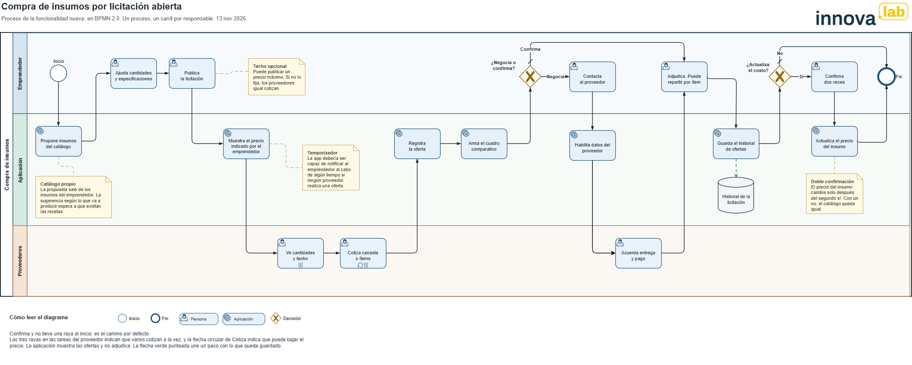

# Compra de insumos por licitación abierta

Proceso de la funcionalidad nueva, en BPMN 2.0. Un proceso, un carril por responsable. 13 de noviembre de 2026.

## Carriles

| Carril | Responsable |
| --- | --- |
| Emprendedor | Persona que publica la licitación y decide. |
| Aplicación | Pasos que ejecuta la aplicación. |
| Proveedores | Proveedores invitados a cotizar. |

## Recorrido

| Paso | Carril | Tarea |
| --- | --- | --- |
| 1 | Emprendedor | **Inicio.** |
| 2 | Aplicación | Propone insumos del catálogo. |
| 3 | Emprendedor | Ajusta cantidades y especificaciones. |
| 4 | Emprendedor | Publica la licitación. |
| 5 | Aplicación | Muestra el precio indicado por el emprendedor. |
| 6 | Proveedores | Ve cantidades y techo. Varios proveedores a la vez. |
| 7 | Proveedores | Cotiza canasta o ítems. Varios proveedores a la vez; cada uno puede repetir para bajar el precio. |
| 8 | Aplicación | Registra la oferta. |
| 9 | Aplicación | Arma el cuadro comparativo. |
| 10 | Emprendedor | **Decisión: ¿Negocia o confirma?** |
| 11 | Emprendedor | Adjudica. Puede repartir por ítem. |
| 12 | Aplicación | Guarda el historial de ofertas, en el **Historial de la licitación**. |
| 13 | Emprendedor | **Decisión: ¿Actualiza el costo?** |
| 14 | Emprendedor / Aplicación | **Fin.** |

## Decisiones

### ¿Negocia o confirma?

- **Confirma** (camino por defecto): pasa directo a *Adjudica. Puede repartir por ítem*.
- **Negocia**:
  1. *Contacta al proveedor* (Emprendedor).
  2. *Habilita datos del proveedor* (Aplicación).
  3. *Acuerda entrega y pago* (Proveedores).
  4. Vuelve a *Adjudica. Puede repartir por ítem*.

### ¿Actualiza el costo?

- **No** (camino por defecto): termina el proceso y el catálogo queda igual.
- **Sí**:
  1. *Confirma dos veces* (Emprendedor).
  2. *Actualiza el precio del insumo* (Aplicación).
  3. Termina el proceso.

## Notas del diagrama

| Nota | Ubicación | Texto |
| --- | --- | --- |
| Catálogo propio | Propone insumos del catálogo | La propuesta sale de los insumos del emprendedor. La sugerencia según lo que va a producir espera a que existan las recetas. |
| Techo opcional | Publica la licitación | Puede publicar un precio máximo. Si no lo fija, los proveedores igual cotizan. |
| Temporizador | Muestra el precio indicado por el emprendedor | La app debería ser capaz de notificar al emprendedor al cabo de algún tiempo si ningún proveedor realiza una oferta. |
| Doble confirmación | Actualiza el precio del insumo | El precio del insumo cambia solo después del segundo sí. Con un no, el catálogo queda igual. |

## Cómo leer el diagrama

| Símbolo | Significado |
| --- | --- |
| Círculo fino | Inicio. |
| Círculo grueso | Fin. |
| Tarea con ícono de persona | La hace una persona. |
| Tarea con ícono de engranaje | La hace la aplicación. |
| Rombo con cruz | Decisión. |
| Cilindro | Lo que queda guardado. |

- *Confirma* y *No* llevan una raya al inicio: es el camino por defecto.
- Las tres rayas en las tareas del proveedor indican que varios cotizan a la vez, y la flecha circular de *Cotiza* indica que puede bajar el precio.
- La aplicación muestra las ofertas y no adjudica.
- La flecha verde punteada une un paso con lo que queda guardado.

## Diferencias con decisiones posteriores

El diagrama es del 13 de noviembre de 2026. Estas decisiones, registradas en [Especificaciones](04-especificaciones.md), cambian lo que muestra:

| Decisión | Qué cambia en el diagrama |
| --- | --- |
| ES-01 (20 nov 2026) | La cotización se hace por rondas automáticas con precio objetivo, no en una ventana única. |
| ES-02 (20 nov 2026) | La nota *Techo opcional* queda reemplazada: el precio de partida es obligatorio y la aplicación sugiere el precio del catálogo. |
| ES-04 (21 nov 2026) | La nota *Temporizador* queda definida: el aviso llega al terminar la primera ronda sin ofertas, y la licitación puede cerrar desierta. |
| ES-05 (21 nov 2026) | *Cotiza canasta o ítems* se hace siempre por ítem: la canasta solo agrupa insumos, y el proveedor puede cotizar solo algunos. |
| ES-06 (21 nov 2026) | *Habilita datos del proveedor* significa avisarle al proveedor y pasarle el contacto del emprendedor. El emprendedor ya veía los datos del proveedor desde el inicio. |
| ES-10 (21 nov 2026) | Los avisos a proveedores y al emprendedor se ven solo en el panel de la aplicación, sin mails. |
| ES-11 (21 nov 2026) | Después de *Adjudica*, la aplicación arma una orden de compra por proveedor adjudicado y, si el emprendedor lo pide, muestra una nota de agradecimiento a los no elegidos. Ninguna de las dos está en el diagrama. |
