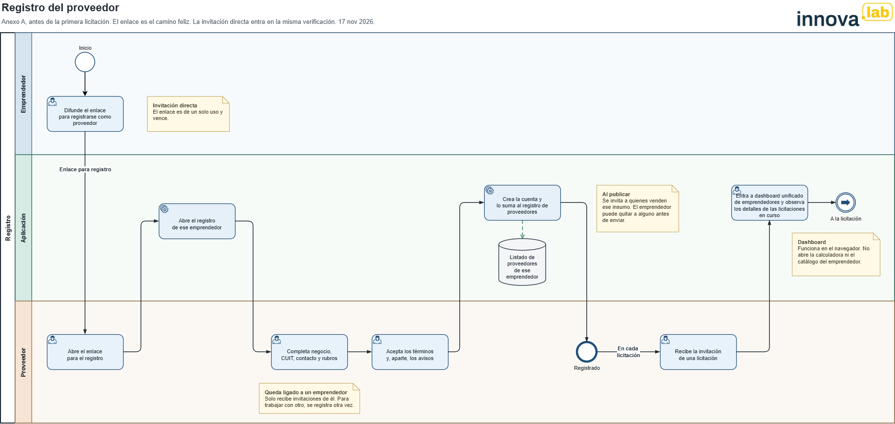

# Registro del proveedor

Anexo A, antes de la primera licitación. El enlace es el camino feliz. La invitación directa entra en la misma verificación. 17 de noviembre de 2026.

## Carriles

| Carril | Responsable |
| --- | --- |
| Emprendedor | Persona que invita a sus proveedores. |
| Aplicación | Pasos que ejecuta la aplicación. |
| Proveedor | Proveedor que se registra. |

## Recorrido

| Paso | Carril | Tarea |
| --- | --- | --- |
| 1 | Emprendedor | **Inicio.** |
| 2 | Emprendedor | Difunde el enlace para registrarse como proveedor. |
| 3 | Proveedor | Abre el enlace para el registro (recibe el *Enlace para registro*). |
| 4 | Aplicación | Abre el registro de ese emprendedor. |
| 5 | Proveedor | Completa negocio, CUIT, contacto y rubros. |
| 6 | Proveedor | Acepta los términos y, aparte, los avisos. |
| 7 | Aplicación | Crea la cuenta y lo suma al registro de proveedores, en el **Listado de proveedores de ese emprendedor**. |
| 8 | Proveedor | **Registrado.** |
| 9 | Proveedor | Recibe la invitación de una licitación (en cada licitación). |
| 10 | Aplicación | Entra a dashboard unificado de emprendedores y observa los detalles de las licitaciones en curso. |
| 11 | Aplicación | **A la licitación** (continúa en [Compra de insumos por licitación abierta](02-proceso-compra-insumos.md)). |

## Notas del diagrama

| Nota | Ubicación | Texto |
| --- | --- | --- |
| Invitación directa | Difunde el enlace | El enlace es de un solo uso y vence. |
| Queda ligado a un emprendedor | Completa negocio, CUIT, contacto y rubros | Solo recibe invitaciones de él. Para trabajar con otro, se registra otra vez. |
| Al publicar | Crea la cuenta | Se invita a quienes venden ese insumo. El emprendedor puede quitar a alguno antes de enviar. |
| Dashboard | Entra a dashboard unificado | Funciona en el navegador. No abre la calculadora ni el catálogo del emprendedor. |

## Diferencias con decisiones posteriores

El diagrama es del 17 de noviembre de 2026. Estas decisiones, registradas en [Especificaciones](04-especificaciones.md) y [Decisiones en duda](05-decisiones-en-duda.md), cambian o confirman lo que muestra:

| Decisión | Qué cambia en el diagrama |
| --- | --- |
| DD-01 (21 nov 2026) | Se confirma para la primera versión: el proveedor entra solo por el enlace de un emprendedor y no hay registro público. |
| ES-07 (21 nov 2026) | La nota *Al publicar* cambia: no se invita solo a quienes venden ese insumo, sino que aparecen todos los proveedores registrados preseleccionados, con sus rubros a la vista, y el emprendedor quita a los que no van. |
| ES-08 (21 nov 2026) | La nota *Queda ligado a un emprendedor* cambia: el proveedor tiene una sola cuenta y, si otro emprendedor lo invita, entra con ella y queda vinculado también a él, sin registrarse otra vez. El dashboard unificado muestra las licitaciones de todos sus emprendedores. |
